# Runge-Kutta methods in 16-bit fixed point

This project searched for Runge-Kutta coefficients that give the lowest error on a small chip
with no floating-point unit. A container ran the search from 2026-08-29 to 2026-11-10, with some
stops. A language model chose the direction of each cycle, but code did every score, and the
search could not change that code. The run is complete, and no more compute goes to it.

**Site, with a live demo and every claim:** [jgoetzmann.github.io/numeric-integration-methods-exploration](https://jgoetzmann.github.io/numeric-integration-methods-exploration/)

## The result



- In Q15 with floor rounding, at a budget of 65,536 cycles, the best discovered method has
  2.95x lower held-out error than midpoint. Midpoint is the best of eight classical methods.
- All 16 archive cells that a discovered method holds beat all eight classical methods.
- The compiled step (GCC 13.2.1, Cortex-M0+) agrees with the Python evaluator in 144 of 144 cases.
- The harness has 1,908 tests, and 91 golden and canary cases must pass before a cycle starts.

## The limits

- The 2.95x is an epoch-1 result. A later audit found an error in the epoch-1 cost model, and
  epoch 2 did not measure the lead again.
- The search picked elites on held-out error, so the lead has selection bias.
- On traced whole-step cost the lead is only 1.01x. With round to nearest, rk38 does better.
- In float64, rk4 is 1,992 to 420,975 times more accurate than the champion.

The site gives all [28 claims](https://jgoetzmann.github.io/numeric-integration-methods-exploration/#claims),
each with its verdict, its limits and the files that show it.

## What is in this repository

| Folder | What it holds |
| --- | --- |
| [`harness/`](harness) | The search: runner, pinned verifier, Q15 evaluator, cost model, container and tests. |
| [`run-data/`](run-data) | The final run data: validation, trace, benchmark, hypotheses and lane results. |
| [`analysis/`](analysis) | The scripts that compute the key findings from the run data. |
| [`ml-2025/`](ml-2025) | The 2025 machine-learning project, and an audit note about its claims. |
| [`site/`](site), [`data/`](data), [`docs/`](docs) | The site source, its snapshot of numbers, and the built site. |

The [final-archive release](https://github.com/jgoetzmann/numeric-integration-methods-exploration/releases/tag/final-archive)
has the raw archive logs (1.3 GB), the final findings site, and the full git history of the five
old repositories: rk-harness, rk-work, rk-findings, rk-overview and
Novel-Numerical-Integration-Methods. These repositories are now folders here.

## Run it

You need Python 3.12 or newer. The tests and one search cycle need no credentials.

```bash
cd harness
python -m venv .venv && . .venv/bin/activate
python -c "import tomllib; p=tomllib.load(open('pyproject.toml','rb'))['project']; print('\n'.join(p['dependencies']+p['optional-dependencies']['test']))" > req.txt
pip install -r req.txt
python -m rk_harness.verifier_hash --check
python -m pytest -q tests
RK_WORK_DIR=/tmp/rk-work RK_FINDINGS_DIR=/tmp/rk-findings python -m rk_harness.runner --once
```

To use the harness for a different search, read
[harness/README.md](harness/README.md#using-it-for-another-search).

To build the site: `python site/build.py`. To check it: `python -m pytest site` and
`python site/ste_check.py`. The site text follows ASD-STE100 (Simplified Technical English).

## License

MIT. See [LICENSE](LICENSE). The `ml-2025/` folder keeps its own MIT license from 2025.
